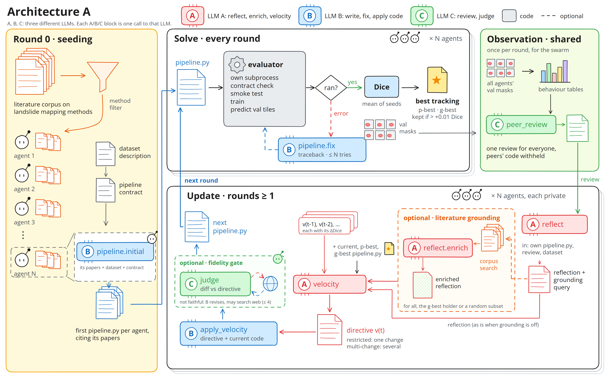

# AutoLSM-Swarm


**A swarm of LLM agents that reads the landslide-mapping literature and evolves its own
segmentation pipelines.** It adapts the particle-swarm framework
[AgentPSO](https://arxiv.org/abs/2605.08704v2) (Hwang et al., 2026) to an Earth-observation
task: mapping landslides from satellite imagery.

Hundreds of landslide-mapping methods have been published, but none generalizes across
regions and sensors, and only about 20% of them release code. AutoLSM-Swarm replaces
paper-by-paper replication with a population of agents. The agents search the published
methods in parallel and learn from each other's results.



---

## Contents

- [How it works](#how-it-works)
- [Quick start](#quick-start)
- [Usage](#usage)
- [Outputs](#outputs)
- [Project structure](#project-structure)
- [Further documentation](#further-documentation)
- [License](#license) · [References](#references)

---

## How it works

Each agent is a PSO **particle**:

- Its **position** is a `pipeline.py` (preprocess → build/train model → predict). The
  pipeline is the only artifact the agent owns and the thing that gets scored.
- Its **velocity** is a natural-language directive for the next change.

Each round runs this loop:

| Step | What happens |
|---|---|
| **1. Solve** | Every agent's pipeline is trained and scored on a fixed train/val split. The score is the **mean Dice over the evaluation seeds**. |
| **2. Peer review** | Deterministic code turns all agents' validation predictions into behavior tables (precision/recall, object-level errors, size strata, complementarity). An LLM writes a comparative report from these tables. Peers' *code* is never shown. |
| **3. Reflect** | Each agent diagnoses its own pipeline against the report. It can also ground the reflection in papers retrieved from the corpus. |
| **4. Velocity update** | The reflection, past trajectory, personal best and global best are merged into one directive. A code LLM applies it to produce the next `pipeline.py`. An optional judge LLM checks that the edit matches the directive. |
| **5. Best tracking** | Personal and global bests are updated only when Dice improves by more than `p_best_epsilon`. |

In **round 0** there are no peers yet. Each agent writes its first pipeline from its own
set of retrieved papers. The swarm uses a **global-best topology**. A run stops after
`n_rounds`, or earlier if the global best does not improve for `plateau_patience` rounds.

**Safety rails.** Every generated pipeline must satisfy a fixed contract
([`pipeline_contract.py`](src/agents/pipeline_contract.py)) and pass a smoke test. It
then runs in an isolated subprocess. If it crashes, the traceback goes back to the LLM
for up to `max_debug_iters` fixes. Scoring code in [`src/eval/`](src/eval/) is fixed, and
agents can never write it.

### Dataset

The default dataset is **[Landslide4Sense](https://github.com/iarai/Landslide4Sense-2022)**
(Ghorbanzadeh et al., 2022): 128×128 tiles with 14 channels (multispectral + DEM) and
binary landslide masks. Tiles are expected as `archive/img/image_N.h5` and
`archive/mask/mask_N.h5`. A seeded 70/15/15 train/val/test split is reused across runs.
The data layer is dataset-agnostic; see [Adding a dataset](docs/datasets.md).

### Literature corpus

The corpus holds about 300 landslide-mapping papers. Each one is summarized as structured
JSON (methods, datasets, novelty, reproducibility) and indexed in a local Chroma vector
store. Retrieved papers are expanded with excerpts from their full text. You can browse
the corpus and its reproducibility survey at
**[fhrochaf.github.io/LSM_ReproViewer](https://fhrochaf.github.io/LSM_ReproViewer/)**.

---

## Quick start

**1. Install dependencies** (requires [uv](https://docs.astral.sh/uv/) and Python ≥ 3.11)

```bash
uv sync
```

**2. Configure.** Create a `.env` file at the repo root with one API key per LLM provider
you use:

```dotenv
ANTHROPIC_API_KEY=...
GOOGLE_GENAI_API_KEY=...
```

In [`src/config.py`](src/config.py) (or in `.env`), point `corpus_json_dir`,
`publications_dir` and `dataset_dir` at your local copies of the corpus and dataset.

The swarm uses three LLM roles. Each role can use a different provider or model:

| Role | Settings | Used for |
|---|---|---|
| Primary | `llm_provider`, `model_name` | Reflection and velocity update |
| Reviewer / judge | `llm_provider_2`, `model_name_2` | Peer review and the fidelity judge (a small model is enough) |
| Code | `llm_provider_3`, `model_name_3` | Writing, updating and debugging `pipeline.py` |

**3. Run**

```bash
python main.py --agents 5 --rounds 10
```

---

## Usage

```bash
python main.py [--agents N] [--rounds T] [--max-train-tiles N] [--n-seeds N]
               [--plateau-patience N] [--rebuild-index] [--resume RUN_ID]
```

| Flag | Description |
|---|---|
| `--agents N` | Swarm size. Ignored with `--resume`. |
| `--rounds T` | Number of rounds. With `--resume`, the round to train up to. |
| `--max-train-tiles N` | Train on at most N tiles, as a cheaper proxy. |
| `--n-seeds N` | Score each pipeline over N of the `eval_seeds`. Cost scales linearly with N. |
| `--plateau-patience N` | Stop after N rounds without a global-best improvement. |
| `--rebuild-index` | Rebuild the literature vector index. |
| `--resume RUN_ID` | Continue an existing run from its saved state. |

All other settings live in [`src/config.py`](src/config.py) and can be overridden from
`.env` or environment variables (e.g. `PROMPTS_FILE=...`, `USE_RAG=false`). The
[configuration guide](docs/configuration.md) explains the less obvious ones:

- prompt variants
- the no-RAG baseline
- retrieval strategies and filters
- observation detail
- the fidelity gate

---

## Outputs

Each run writes to `<runs_dir>/<run_id>/`:

```text
<run_id>/
├── round_<t>/
│   ├── peer_review.md, peer_review_tables.md
│   └── agent_<i>/
│       ├── pipeline.py, reflection.md, velocity.md, velocity_reasoning.md, fidelity.md
│       └── per-seed validation predictions
├── ledger.jsonl          # every round's scores, change sizes, fidelity verdicts
├── state_snapshot.json   # checkpoint used by --resume
├── g_best_pipeline.py    # best pipeline found
├── summary.json
├── prompts_used.yaml     # exact prompts of the run
└── config_used.json      # resolved settings (no API keys)
```

Every finished run is also added to `<runs_dir>/registry.{jsonl,csv}`, together with its
configuration, outcome and per-round curves. To load it as a DataFrame:

```python
from orchestration.registry import load_registry
df = load_registry(runs_dir)
```

---

## Project structure

```text
main.py                  CLI entry point: wires config, RAG index, data cache and graph
src/
├── config.py            Single Settings object (pydantic-settings, reads .env)
├── prompts*.yaml        All LLM prompts; one file per prompt variant
├── agents/              One agent's write → run → debug cycle
│   ├── codegen.py         write / update / fix pipeline.py
│   ├── fidelity.py        judge that checks an update against its velocity
│   ├── runner.py          per-agent loop over seeds, crash-fix retries
│   ├── driver.py          subprocess that executes one pipeline
│   ├── pipeline_contract.py  required interface + smoke test
│   └── structured.py      JSON-structured LLM outputs
├── orchestration/       The swarm loop
│   ├── graph.py           LangGraph round loop, best tracking, checkpointing
│   ├── peer_review.py     peer review → reflect → velocity chain
│   ├── state.py           agent / swarm state
│   └── registry.py        cross-run results registry
├── corpus/              Literature RAG: ingest, retrieve, PDF text extraction
├── data/                Dataset-agnostic loading via DatasetSpec
└── eval/                Fixed metrics, inference and behavior observation
notebooks/               Run analysis and trace viewers
```

---

## Further documentation

- [docs/configuration.md](docs/configuration.md): prompt variants, ablations, retrieval,
  observation detail, the fidelity gate and structured outputs
- [docs/datasets.md](docs/datasets.md): how to add a new dataset

---

## License

GPL-3.0. See [LICENSE.txt](LICENSE.txt).

## References

- Hwang, H., Kim, J., Kim, C., Chang, H., & Ye, J. C. (2026). *AgentPSO: Evolving Agent
  Reasoning Skill via Multi-agent Particle Swarm Optimization*. arXiv:2605.08704.
- Ghorbanzadeh, O., et al. (2022). *The Outcome of the 2022 Landslide4Sense Competition:
  Advanced Landslide Detection From Multisource Satellite Imagery*. IEEE JSTARS.
